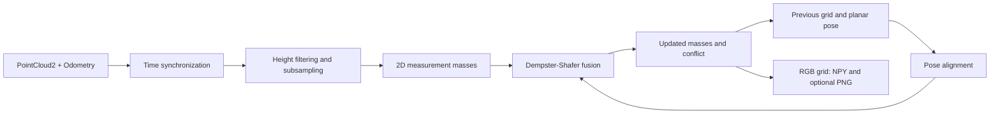

<div align="center">

# EDOG-Map

### Evidential Dynamic Occupancy Grid Mapping for<br>Consumer-Grade UAV Navigation in Dynamic Environments

**Zheng Tan · Zuowei Zhang · Yang Lyu · Quan Pan**

*IEEE Transactions on Consumer Electronics, 2026*<br>
DOI: **10.1109/TCE.2026.3725136**

[**Paper**](https://ieeexplore.ieee.org/abstract/document/11658911/) · [**Video**](https://www.youtube.com/watch?v=SXceoPBKvmA) · [**Quick start**](#quick-start) · [**Documentation**](docs/usage.md) · [**中文**](README_zh-CN.md)

<a href="https://www.youtube.com/watch?v=SXceoPBKvmA"></a>

*Dynamic environment representation from the project demonstration. Click to watch the full video.*

</div>

## Overview

**EDOG-Map represents occupancy, uncertainty, and motion-induced conflict in a unified evidential mapping framework.** It uses Dempster–Shafer theory to distinguish free, occupied, and unknown space, and identifies dynamic cells from conflicts between historical beliefs and current LiDAR observations.

The paper develops three complementary ideas:

- **Explicit uncertainty:** evidential mass assignments distinguish unobserved space from confidently free space.
- **Conflict-driven dynamics:** temporal contradictions reveal changing occupancy without particle-based velocity sampling or predefined object classes.
- **Bounded local mapping:** a robot-centric sliding window limits map storage as the UAV explores a larger environment.

> **Release scope.** This repository currently provides a **Python reference pipeline for ROS 1 with a 2D grid**. The paper describes a C++/ROS experimental system, including 3D mapping and flight evaluations. See [implementation notes](docs/implementation-notes.md) for the differences. The full flight stack, datasets, and benchmark reproduction scripts are not included in this checkout.

## Method and demonstrations

<p align="center">
  
</p>

*Dynamic environment representation from the paper's Fig. 1. Red cells indicate detected dynamics; the camera and point-cloud views provide scene context.*

The released pipeline follows this data flow:



The active LiDAR path uses no image input, pretrained model, or semantic labels. The grid maintains masses in **(unknown, occupied, free)** order; conflict is computed separately before normalization. The visualization marks cells at or above the configured conflict threshold.

<table>
  <tr>
    <td width="50%"></td>
    <td width="50%"></td>
  </tr>
  <tr>
    <td align="center">Campus exploration · paper Fig. 9</td>
    <td align="center">Viaduct environment · paper Fig. 10</td>
  </tr>
</table>

## Results reported in the paper

These are **paper-reported results**, not measurements from this Python release. See Section V of the [paper](https://doi.org/10.1109/TCE.2026.3725136) for the experimental settings and metric definitions.

**Public datasets — Table II (selected dynamic mapping methods).** `t_u` is average map-fusion time per frame; RAM is peak map-maintenance memory. These offline experiments use an Intel i7, 0.2 m grids, and 0.1 m point-cloud downsampling.

| Dataset | Method | `t_u` (ms) ↓ | IoU (%) ↑ | Peak RAM (MB) ↓ |
| :-- | :-- | --: | --: | --: |
| New College | Classified-DOGM | 3.522 | 90.23 | 6,873.195 |
| New College | Instance-RFS | 5.140 | 92.15 | 7,850.420 |
| New College | **EDOG-Map** | **1.702** | **93.72** | **364.737** |
| KITTI 07 | Classified-DOGM | 2,083.774 | 89.56 | 12,574.026 |
| KITTI 07 | Instance-RFS | 3,150.880 | 91.80 | 15,800.500 |
| KITTI 07 | **EDOG-Map** | **1,326.953** | **94.75** | **2,160.263** |

**Dynamic detection — Table III (EDOG-Map, controlled experiments with Vicon ground truth).**

| Sequence | Precision (%) | Recall (%) | F1-score (%) | IoU (%) |
| :-- | --: | --: | --: | --: |
| Sequence 1 | 91.5 | 89.3 | 90.4 | 82.6 |
| Sequence 2 | 88.7 | 86.4 | 87.5 | 78.1 |
| Sequence 3 | 87.2 | 88.1 | 87.6 | 77.8 |

Public-dataset timing, motion-capture detection metrics, and outdoor flight timing are separate experiments. The numbers above do not imply that every sequence exceeds 90% F1 or that the Python pipeline reproduces the deployment latency.

## Quick start

### 1. Set up the Python environment

The ROS entry point targets **ROS 1 / Noetic with Python 3.8 on Ubuntu 20.04**. This is a legacy compatibility target, not a newly validated flight environment. Noetic [reached end of life in May 2025](https://discourse.ros.org/t/new-packages-for-noetic-2025-05-29-final/44003). Use an existing Noetic installation for the commands below; this release has no ROS 2 port.

```bash
git clone https://github.com/HKPolyU-UAV/EDOG-Map.git
cd EDOG-Map

source /opt/ros/noetic/setup.bash
python3 -m venv --system-site-packages .venv
source .venv/bin/activate
python -m pip install -r requirements.txt
```

`--system-site-packages` exposes the ROS Python packages to the virtual environment. The pip package is **`pystream-pipeline`**, imported as `pystream`. TensorFlow and model weights are unnecessary for this LiDAR-only entry point. See the [setup guide](docs/usage.md) for ROS dependencies and troubleshooting.

### 2. Check the core pipeline without ROS

With the Python requirements installed, this check also runs without ROS on Python 3.8–3.11:

```bash
python scripts/smoke_test.py
```

It checks the mapping modules and a small synthetic pipeline with temporary outputs. It does not reproduce the paper or validate flight performance.

### 3. Run with synchronized LiDAR and odometry

Start `roscore` in a separate terminal, then start your LiDAR/odometry source or replay a compatible bag. From the repository root, with ROS sourced and the environment activated:

```bash
python run.py \
  _lidar_topic:=/cloud_registered_body \
  _odom_topic:=/Odometry \
  _z_min:=0.0 \
  _z_max:=5.0 \
  _max_points:=30000
```

| Input | Message type | Required convention |
| :-- | :-- | :-- |
| LiDAR | `sensor_msgs/PointCloud2` | Local/body-frame `x, y, z` in meters; optional `intensity` |
| Odometry | `nav_msgs/Odometry` | Body pose in a consistent world frame; only `x, y, yaw` are used |

**Prepare compatible coordinate frames upstream.** The script performs no TF lookup, sensor-extrinsic transformation, or roll/pitch compensation. A world-frame cloud cannot be substituted directly for a body-frame cloud. See [input conventions, parameters, and bag replay](docs/usage.md).

### 4. Inspect outputs

The default destination is `results/`, relative to the working directory:

```text
results/
├── 000000_dgm_pred.npy
├── 000000_dgm_pred.png
├── 000001_dgm_pred.npy
└── ...
```

Each `.npy` stores a **`uint8` RGB visualization**, with default shape `(1000, 1000, 3)`. PNG output is generated when Matplotlib is available. These files do not contain the underlying evidential masses.

| Color | Meaning in the released renderer |
| :-- | :-- |
| Gray `(123, 123, 123)` | Unknown |
| Black `(0, 0, 0)` | Occupied |
| White `(255, 255, 255)` | Free |
| Red `(255, 0, 0)` | Conflict at or above the dynamic threshold |

There is currently no ROS map publisher, planner interface, or velocity estimate. [Implementation notes](docs/implementation-notes.md) document behavior and edge cases to review before extending the reference implementation.

## Repository guide

| Path | Purpose |
| :-- | :-- |
| [`run.py`](run.py) | ROS subscriptions, synchronization, filtering, and pipeline entry point |
| [`libs/dgm.py`](libs/dgm.py) | Measurement masses, fusion, pose alignment, and visualization |
| [`pipeline/`](pipeline/) | Stage wrappers, data containers, and file output |
| [`libs/ogm.py`](libs/ogm.py) | Conventional occupancy-grid utilities outside the active entry point |
| [`docs/usage.md`](docs/usage.md) | Installation, parameters, input contract, and troubleshooting |
| [`docs/implementation-notes.md`](docs/implementation-notes.md) | Release scope and known implementation issues |
| [`scripts/smoke_test.py`](scripts/smoke_test.py) | Synthetic checks independent of ROS |
| [`docs/assets/`](docs/assets/) | Figures and compact demo preview; [asset provenance](docs/assets/README.md) |

## Citation

If this work is useful in your research, please cite:

```bibtex
@article{tan2026edogmap,
  author  = {Tan, Zheng and Zhang, Zuowei and Lyu, Yang and Pan, Quan},
  title   = {{EDOG-Map}: Evidential Dynamic Occupancy Grid Mapping for
             Consumer-Grade {UAV} Navigation in Dynamic Environments},
  journal = {IEEE Transactions on Consumer Electronics},
  year    = {2026},
  doi     = {10.1109/TCE.2026.3725136},
  url     = {https://doi.org/10.1109/TCE.2026.3725136}
}
```

Metadata follows the accepted author version. Volume, issue, and page numbers are omitted until verified. A machine-readable citation is provided in [`CITATION.cff`](CITATION.cff).

## Contributions and contact

For setup questions and reproducible issues, use [GitHub Issues](https://github.com/HKPolyU-UAV/EDOG-Map/issues). Include the environment, topic/frame conventions, parameters, and a minimal example. See [CONTRIBUTING.md](CONTRIBUTING.md).

Research contact: **Zheng Tan** — [tanz@mail.nwpu.edu.cn](mailto:tanz@mail.nwpu.edu.cn).

## License

A software license has not yet been specified in this repository. Please contact the authors regarding reuse terms. Paper and media rights are separate from the software license; the publisher PDF is linked rather than redistributed here.
