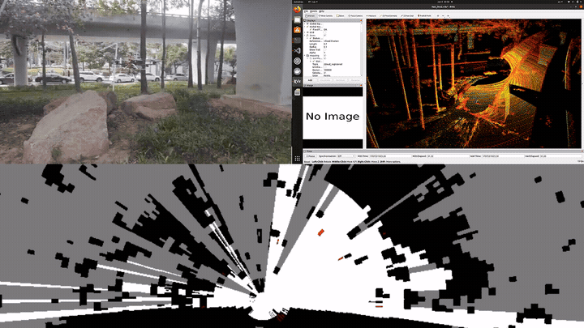
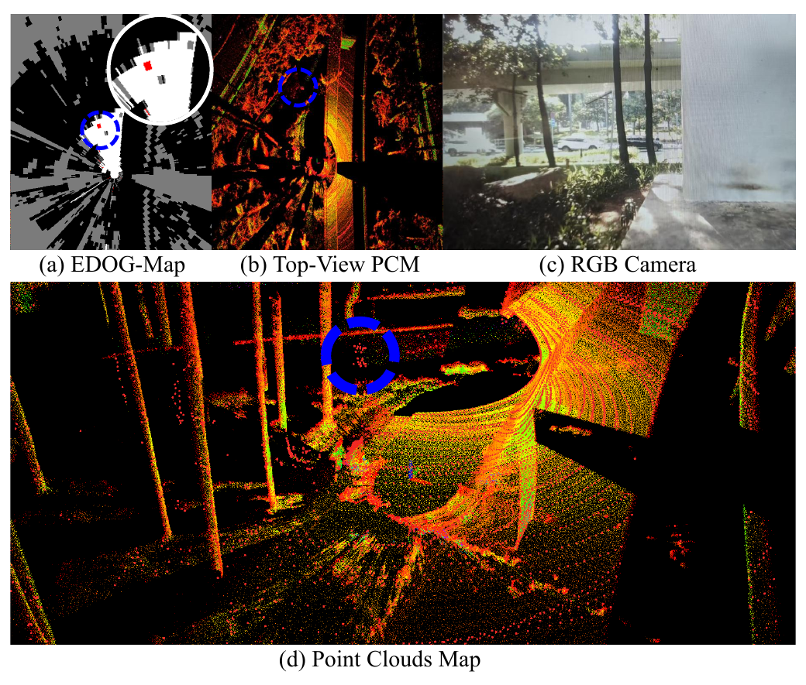
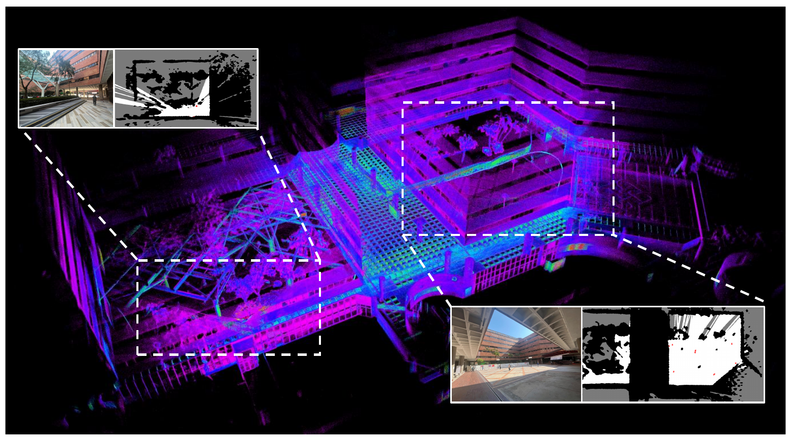
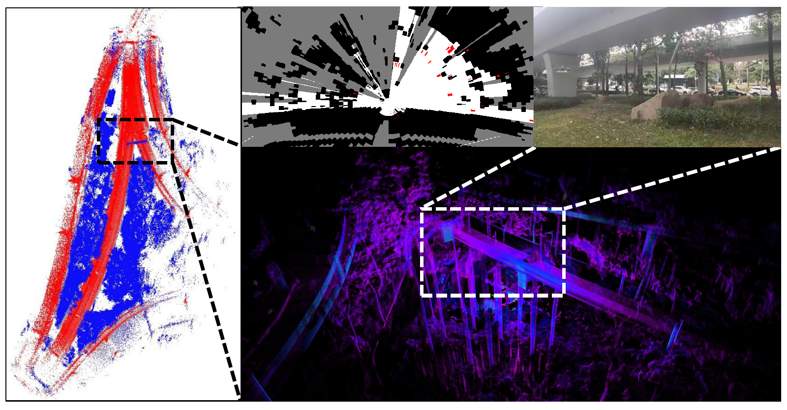

<div align="center">

# EDOG-Map

### 面向动态环境中消费级无人机导航的证据动态占据栅格建图


*IEEE Transactions on Consumer Electronics, 2026*<br>
DOI：**10.1109/TCE.2026.3725136**

[**论文**](https://ieeexplore.ieee.org/abstract/document/11658911/) · [**视频**](https://www.youtube.com/watch?v=SXceoPBKvmA) · [**快速开始**](#快速开始) · [**使用文档**](docs/usage.md) · [**English**](README.md)

<a href="https://www.youtube.com/watch?v=SXceoPBKvmA"></a>

*项目演示中的动态环境表示。点击预览观看完整视频。*

</div>

## 项目简介

**EDOG-Map 在统一的证据建图框架中表示空间占据、不确定性和运动引起的冲突。** 方法基于 Dempster–Shafer 证据理论区分空闲、占据和未知空间，并利用历史信念与当前 LiDAR 观测之间的冲突识别动态栅格。

论文的主要思路包括：

- **显式表示不确定性：** 使用证据质量分配区分未观测空间与具有充分证据的空闲空间。
- **通过冲突识别动态：** 利用时序证据矛盾发现占据变化，无需基于粒子的速度采样或预定义目标类别。
- **限制局部地图规模：** 使用以机器人为中心的滑动窗口，在探索大范围环境时限制地图存储规模。

仓库提供基于 **ROS 1 的 Python 二维栅格建图流水线**，涵盖点云接入、证据融合、动态栅格识别和地图输出，详见[使用文档](docs/usage.md)。

## 方法与效果展示

<p align="center"></p>

*论文图 1：动态环境表示。红色栅格表示检测到的动态，相机和点云视图展示对应场景。*

当前代码的数据流程为：**点云与里程计同步 → 高度过滤及下采样 → 二维观测证据 → 历史地图位姿对齐 → Dempster–Shafer 融合 → 更新质量与冲突 → RGB 栅格输出**。

LiDAR 流水线直接处理点云与里程计。地图质量通道顺序为 **未知、占据、空闲**；冲突在归一化之前单独计算，达到设定阈值的栅格在可视化中标红。

<table>
  <tr>
    <td width="50%"></td>
    <td width="50%"></td>
  </tr>
  <tr>
    <td align="center">校园探索 · 论文图 9</td>
    <td align="center">高架桥环境 · 论文图 10</td>
  </tr>
</table>

## 快速开始

### 1. 配置环境

ROS 入口使用 **Ubuntu 20.04 / ROS 1 Noetic / Python 3.8**。在已安装 Noetic 的环境中执行：

```bash
git clone https://github.com/HKPolyU-UAV/EDOG-Map.git
cd EDOG-Map
source /opt/ros/noetic/setup.bash
python3 -m venv --system-site-packages .venv
source .venv/bin/activate
python -m pip install -r requirements.txt
```

`--system-site-packages` 使虚拟环境能够访问系统 ROS Python 包。依赖包名为 **`pystream-pipeline`**，导入名为 `pystream`。当前 LiDAR 入口不需要 TensorFlow 或模型权重。ROS 依赖和排错步骤见[使用文档](docs/usage.md)。

### 2. 无 ROS 核心检查

安装 Python 依赖后，可在 Python 3.8–3.11 环境运行：

```bash
python scripts/smoke_test.py
```

该脚本检查证据质量归一化、融合、RGB 渲染和两帧流水线输出，并自动清理临时文件。

### 3. 接入同步点云与里程计

在单独终端启动 `roscore`，再启动点云和里程计来源，或回放符合输入要求的 bag。在仓库根目录、已加载 ROS 且激活虚拟环境的终端运行：

```bash
python run.py \
  _lidar_topic:=/cloud_registered_body \
  _odom_topic:=/Odometry \
  _z_min:=0.0 \
  _z_max:=5.0 \
  _max_points:=30000
```

| 输入 | 消息类型 | 坐标约定 |
| :-- | :-- | :-- |
| LiDAR | `sensor_msgs/PointCloud2` | 局部/机体系 `x, y, z`，单位为米；`intensity` 可选 |
| 里程计 | `nav_msgs/Odometry` | 一致世界坐标系下的机体位姿，仅使用 `x, y, yaw` |

接入前，请在上游完成所需的坐标变换、传感器外参变换及横滚/俯仰补偿，使点云与里程计采用一致的机体坐标约定。输入要求、参数和 bag 回放方法见[使用文档](docs/usage.md)。

### 4. 查看输出

输出默认保存在当前工作目录的 `results/` 下，文件形如 `000000_dgm_pred.npy` 和 `000000_dgm_pred.png`，按帧编号递增。

`.npy` 保存 **`uint8` RGB 可视化图**，默认形状为 `(1000, 1000, 3)`。Matplotlib 可用时同时生成 PNG，证据质量数组的访问方式见[使用文档](docs/usage.md#6-outputs)。

| 颜色 | 当前渲染器中的含义 |
| :-- | :-- |
| 灰色 `(123, 123, 123)` | 未知 |
| 黑色 `(0, 0, 0)` | 占据 |
| 白色 `(255, 255, 255)` | 空闲 |
| 红色 `(255, 0, 0)` | 冲突达到动态阈值 |

[实现说明](docs/implementation-notes.md)介绍地图更新细节与后续开发事项。

## 仓库结构

| 路径 | 内容 |
| :-- | :-- |
| [`run.py`](run.py) | ROS 订阅、同步、过滤与流水线入口 |
| [`libs/dgm.py`](libs/dgm.py) | 观测证据、融合、位姿对齐与可视化 |
| [`pipeline/`](pipeline/) | 流水线阶段、数据容器与输出 |
| [`libs/ogm.py`](libs/ogm.py) | 当前入口之外的传统占据栅格工具 |
| [`docs/usage.md`](docs/usage.md) | 安装、参数、输入要求与排错 |
| [`docs/implementation-notes.md`](docs/implementation-notes.md) | 实现细节与开发说明 |
| [`scripts/smoke_test.py`](scripts/smoke_test.py) | 不依赖 ROS 的合成检查 |
| [`docs/assets/`](docs/assets/) | 图片与演示预览；[素材来源](docs/assets/README.md) |

## 引用

如果本工作对您的研究有帮助，请引用：

```bibtex
@article{tan2026edogmap,
  author  = {Tan, Zheng and Zhang, Zuowei and Lyu, Yang and Pan, Quan},
  title   = {{EDOG-Map}: Evidential Dynamic Occupancy Grid Mapping for
             Consumer-Grade {UAV} Navigation in Dynamic Environments},
  journal = {IEEE Transactions on Consumer Electronics},
  year    = {2026},
  doi     = {10.1109/TCE.2026.3725136},
  url     = {https://doi.org/10.1109/TCE.2026.3725136}
}
```

机器可读引文见 [`CITATION.cff`](CITATION.cff)。

## 贡献与联系

安装问题和可复现的问题请提交至 [GitHub Issues](https://github.com/HKPolyU-UAV/EDOG-Map/issues)，附环境信息、话题/坐标约定、参数和最小示例。提交修改前请阅读 [CONTRIBUTING.md](CONTRIBUTING.md)。研究联系：**Zheng Tan**，[tanz@mail.nwpu.edu.cn](mailto:tanz@mail.nwpu.edu.cn)。

## 许可证

软件许可证待补充，使用条款请联系作者。
